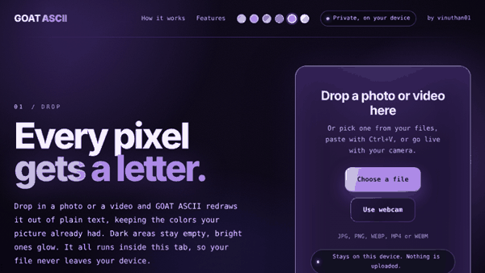

<div align="center">

### 🌐 **Live site: [vinuthan01.github.io/GOAT_ASCII](https://vinuthan01.github.io/GOAT_ASCII/)**

# GOAT ASCII

**Every pixel gets a letter.**
Turn photos, videos and your webcam into live, full-color ASCII art. Runs 100% in your browser.

[**Open the live site**](https://vinuthan01.github.io/GOAT_ASCII/) · [Report a bug](../../issues) · [MIT License](LICENSE)



</div>

## Try it in 10 seconds
1. Open **https://vinuthan01.github.io/GOAT_ASCII/**
2. Click one of the three sample tiles, or drop in your own photo or video (or press **Use webcam**).
3. Move the slider to compare, scroll to zoom, and press **Export** to save your art.

## Features
- **Photo, video and webcam** to live ASCII, keeping the original colors (default)
- **Before/after slider** (press `B`) to compare the original with the ASCII version
- **Tune the look:** classic letters, blocks, braille dots, binary or your own word; brightness, contrast, invert
- **Styles:** Original colors, White on black, Black on white, Phosphor, Amber, Neon duotone, Violet, Ice, Sunset, Rose, Crimson, Rainbow (press `S` to cycle)
- **Export:** PNG, standalone HTML page, animated video with presets (Quick share, Standard, Crisp), estimated file size and a progress bar
- **Zoom into any area** while viewing: mouse wheel, `+` / `-` keys, the zoom buttons, double-click, or pinch on touch; drag to pan and press `0` to reset. The ASCII is re-drawn at every zoom level, so the letters stay sharp
- **Video controls like a video player**: click the picture to play or pause, and the toolbar and bar hide while a video plays and come back when you move the mouse or tap
- **Copy as text** or save a `.txt` file; paste an image with `Ctrl+V`
- **Six colour themes** (Sunset, Ice, Phosphor, Amber, Aurora, Mono): click the coloured dots in the top bar; your choice is remembered. The default is **Aurora**, a violet/orchid purple theme. Change it by editing `data-theme` on the `<html>` tag in `index.html`
- **"Aurora terminal" look**: drifting purple light, film grain, glass panels, glossy buttons and a soft cursor glow, all CSS transform/opacity (no per-frame JS). Everything pauses when the viewer is open, the tab is hidden, or reduced motion is on
- **Wide-screen extras** (shown at 1400 px and wider): falling ASCII rails on both edges, a sticky section index (01 Drop, 02 Samples, 03 How, 04 Features) with a progress line, vertical side text, HUD corner brackets with a size readout, and a wider content area
- **Three sample videos** (Butterfly, Samurai, BMW M3 GTR) on the home page if you have no file handy. Each tile plays a moving half-original / half-ASCII preview and opens full size with the comparison slider already on
- **Keyboard controls** (press `?` in the viewer) and mobile-friendly touch controls
- **Remembers your settings**, works offline, and installs as an app (PWA)
- Clear loading and error messages; browser Back returns to the home page

## Privacy
Your files and camera feed are read by your browser and drawn on a canvas. Nothing is uploaded, there is no account and there is no tracking.

## Run locally
Open `index.html` in a modern browser, or serve the folder (needed for webcam and install):
```bash
python3 -m http.server 8000   # then visit http://localhost:8000
```
Keep `hero-background.html` next to `index.html`; it is the animated backdrop.

## Hosting
The site is static (no build step) and runs on GitHub Pages at `https://vinuthan01.github.io/GOAT_ASCII/`. It also works when `index.html` is opened straight from disk. The Open Graph image URL in `index.html` points to `https://vinuthan01.github.io/GOAT_ASCII/assets/og.png`.

## Keyboard
| Key | Action |
|---|---|
| `Space` | Play / pause |
| `←` `→` | Seek 5s (or move the compare line) |
| `↑` `↓` | More / less detail |
| `B` `S` `T` `E` `F` | Compare, style, tune panel, export menu, full screen |
| `+` `-` `0` | Zoom in, zoom out, reset zoom (the mouse wheel also zooms) |
| Click the picture | Play / pause (the controls hide while a video plays) |
| `Esc` | Close panels |

## Tests
```bash
pip install playwright && playwright install chromium
python tests/smoke.py
```

## Tips
- For sharper close-ups, raise the **Detail** slider, then zoom in.
- **Black on white** looks cleanest on photos with a dark background. If a bright photo looks too dense, turn on **Invert** in Tune.
- On a slower laptop or phone, lower Detail for smoother video.
- After an update, hard refresh (Ctrl+Shift+R) once so the browser drops its cached copy.

## Notes
- Video export records in real time, so a 1-minute video takes 1 minute.
- Brightness/contrast/invert use the canvas filter API, which older Safari versions lack.
- Some phone videos (HEVC) cannot be decoded by desktop browsers; convert them to H.264 MP4.

Built by [vinuthan01](https://github.com/vinuthan01).
